# Early Warning of Food-Price Spikes in Tanzanian Markets

**Can we predict, one month ahead, which market–commodity price series will rise by more than 10%, so that Tanzania's Ministry of Agriculture can act early, by releasing reserve stock or prioritising market monitoring?**

Mini-project for *Z3003 Data Mining: Scaling to Large Data*, IIT Madras Zanzibar (BS Semester 5, DSAI).
Author: **Shambhavi Srivastava** (ZDA24B005) · Dataset approved by Dr. I. Nyalala, 20 October 2026.

---

## Project status

| Section | Content | Status |
|---|---|---|
| 1 · Data understanding | Shape, attribute types, missing values, data-quality dimensions | ✅ Complete |
| 2 · Exploratory analysis | Summaries, decision-based spike threshold, correlation + confounder, χ² tests, Gower and haversine distance, dependence-aware uncertainty, evaluation plan | ✅ Complete (revised after instructor feedback, 10 Nov) |
| 3 · Preprocessing | Peer-based outlier cleaning, missing-month strategy, past-only features with a leakage test, shape-based robust scaling fitted on training data, entropy discretization, PCA check | ✅ Complete |
| 4 · Mining | Classification: decision tree, Naive Bayes and random forest against three baselines, rolling-origin CV, pre-declared selection rule, corrected paired t-tests, one-time test with bootstrap intervals, breakdowns by year / subgroup / region, threshold sensitivity | ✅ Complete |
| 5 · Findings | Recommendations, scaling to 1,000× the data, ethics (fairness, misuse, privacy), limits and extensions; [one-page summary](Shambhavi_MiniProject_Summary.pdf) | ✅ Complete |

**Instructor feedback:** all nine points from 10 Nov have been addressed; Sections 1–3 were reviewed as satisfactory on 18 Nov. See [FEEDBACK.md](FEEDBACK.md) for what changed and where.

**Evaluation design (set by the instructor, 10 Nov 2026):** one time split for all series. Training uses 2006–2021, with all tuning by rolling-origin cross-validation inside these years (validation years 2017–2021). The primary test is **Jan 2023 – Sep 2026, wholesale only**; 2022 (retail and wholesale, reported separately) is a secondary check. Missing Zanzibar markets are stated as a limitation; the data are not extended.

---

## Data

World Food Programme, *United Republic of Tanzania — Food Prices* and *Markets*, via the Humanitarian Data Exchange (downloaded 9 November 2026).

| | |
|---|---|
| Price table | 67,999 rows × 16 columns · Jan 2006 – Sep 2026 · 870 price series |
| Coverage | 63 markets in mainland Tanzania (no Zanzibar markets) · 31 commodities · retail and wholesale |
| Unit of analysis | One series-month: one commodity, in one market, in one unit, at one price level, in one month |

---

## Headline result

On the untouched test period (Jan 2023 – Sep 2026, wholesale, 760 spikes in 8,000 series-months), a **random forest** that flags the 16% of series it rates most at risk each month:

| | Random forest | Rule of thumb: "spiked last month" |
|---|---|---|
| Real spikes caught (recall) | **35.4%** (95% CI 31.3–39.2) | 17.4% |
| Flags that were real spikes (precision) | **21.1%** (CI 18.8–23.3) | 17.7% |
| ROC-AUC | **0.677** (CI 0.656–0.696) | 0.545 |
| PR-AUC lift over chance | **2.0×** | 1.15× |

The gain in recall over the rule of thumb is **+18.0 points (CI 13.6–22.4)**. The gain is not only from raising more alerts: given exactly the rule's workload (9.3% of series flagged), the model catches **24.2%** of spikes vs 17.4%, with precision **24.0%** vs 17.7%. The base spike rate is 9.5%, so a random shortlist would be right about 1 time in 10. Plain-language summary: [Shambhavi_MiniProject_Summary.pdf](Shambhavi_MiniProject_Summary.pdf).

---

## Key findings

**Data understanding (Section 1)**
- **No empty cells, but 7.0% of expected months have no row** (5,141 of 73,140). The gaps are systematic: wholesale series miss 15.2% of months versus 2.4% for retail (χ² test), and the rate varies by region and year.
- **The gaps do not hide price jumps,** but comparing a price with the last *available* price would more than double the spike rate (28.4% vs 12.4%). Labels are therefore built from consecutive months only.
- **Data-quality issues found:** all 30 "MT" rows are really per-kg prices; one entry error (3,000,000 TZS/kg); 65 wrong USD prices; retail series end in 2022.

**Exploratory analysis (Section 2, training years 2006–2021 only)**
- **Spikes are common and heavy-tailed:** 11.9% of months rise by more than 10%. A normal curve with the same spread would predict 0.16%.
- **The 10% threshold is justified by the Ministry's decision:** food is 59.9% of household spending (NBS HBS 2017/18), and a 10% jump in one month far exceeds a typical series' yearly drift (+0.3%/yr). About two in three such jumps leave prices still ≥10% higher three months later, and the threshold flags about 16 of every 100 wholesale series a month (versus 28 at 5%, or only 12% of lasting rises caught at 20%). The statistics agree: 10% ≈ the boxplot outlier fence (+9.7%) and the 88th percentile.
- **Confounder:** maize and rice prices correlate at ρ = 0.79, but the shared rise in prices over time (6–8% a year) drives this. Their month-to-month changes correlate at only ρ = 0.36.
- **Spikes cluster:** the chance of a spike rises from 10.6% to 20.3% when there was a spike the month before.
- **Season and product matter:** maize spike risk is 21–30% in October–January (the lean season). Vegetables spike most often, meat least.
- **Retail prices look "sticky":** 46% of retail monthly changes are exactly zero (8% for wholesale), suggesting carried-forward prices.
- **Nearby markets move together:** price changes correlate at about 0.35 for markets under 250 km apart versus 0.19 beyond 1,000 km (haversine distance; Mantel test p = 0.0001).
- **The observations are not independent** (repeated months, markets moving together). Resampling whole series and whole months gives honest intervals 1.8–5× wider than naive ones, and every key finding still holds.
- **The evaluation must handle three shifts:** the spike rate drifts (wholesale 6–32% by year; 9.6% in the test years); training is 77% retail while the test is 100% wholesale; and wholesale prices are increasingly reported unchanged (15% of months in 2021 → 57% in 2026). The evaluation plan (§2.6) addresses each.

**Preprocessing (Section 3)**
- **Outliers are judged against other markets in the same month,** not against a series' own history. The textbook series-level rule breaks for 141 series with MAD = 0 and would delete genuine spikes. The peer-based rule flags 226 prices (0.33%, including the 3,000,000 TZS/kg error), removes 0.7% of training labels and leaves the spike rate almost unchanged (11.92% → 11.80%).
- **Missing months are never filled for labels, and never interpolated for features** (interpolation uses future prices). Remaining feature gaps are filled with training-period group medians.
- **15 features use only past months or information known in advance** (calendar month, commodity). A scrambling test proves it: replacing every price from June 2019 onwards with random numbers leaves all earlier features unchanged.
- **Every feature is skewed or heavy-tailed,** so robust z-scores (with log and clipping where needed) are used, all fitted on 2006–2021. Fitting on all years would have shifted one scale by 33%.
- **Entropy discretization reveals a U-shaped risk:** a spike follows 25% of sharp falls and 20% of sharp rises, but only 5% of unchanged prices. **PCA is not used:** the largest correlation is 0.73 and 7 of 9 components are needed for 90% of the variance.

**Mining (Section 4)**
- **The selection rule was fixed before any results were seen:** pick the best mean cross-validated PR-AUC, unless a simpler model is within one standard error. CV PR-AUC on wholesale rows: lazy 0.133, persistence 0.142, seasonal 0.133, decision tree 0.201, Naive Bayes 0.211, **random forest 0.271**. The forest won all five folds against every alternative (corrected paired t-test vs baselines p ≤ 0.017).
- **Training on wholesale rows only beat using all rows** (tree 0.201 vs 0.180), consistent with the retail→wholesale shift found in §2.6.
- **Alert rule:** a monthly budget (flag the top 15.7%, the training spike share) beat a fixed probability cut-off, which flagged only 5.6% of series in the test years because the predicted risk drifted.
- **Stable across time:** recall rose from 28% (2023) to 44% (2026). The 2022 check gave the same picture for wholesale (precision 33.9%, recall 25.5%) and retail (23.7%, 26.3%; persistence 13.9%, 13.5%).
- **Where it is weaker:** series first seen after 2021 (recall 28% vs 38%), stale quotes (18% vs 38%), and some regions (12% in Tabora vs 51% in Kigoma). These are reported as fairness findings in §5.3.
- **What drives the warnings:** a rise in the national price last month (26% of forest importance), especially for maize; the share of all series nationwide that spiked in the last 3 months (13%); distance from the 12-month average (10%); the calendar month (11%). A readable depth-2 tree finds the same rules.
- **The 10% threshold is not cherry-picked:** at 5%, 15% and 20% the ROC-AUC stays at 0.67–0.70 and recall stays about double that of persistence.

**Findings (Section 5)**
- Use the model as a **monthly shortlist** for officers to verify, re-trained yearly; do not publish it, as traders could use it to hoard.
- At 1,000× the data (about 68 million rows) the pipeline maps to partitioned window functions, approximate quantiles, histogram-based trees on a stratified sample, and incremental monthly scoring.

---

## Figures

**Coverage and missing months**
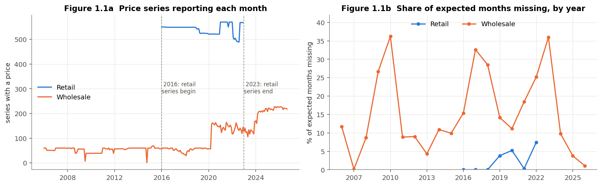

**Monthly price changes are heavy-tailed**
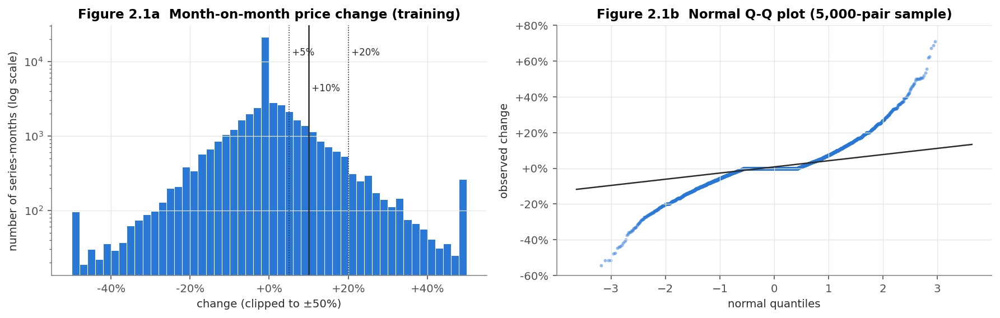

**When and where spikes happen**
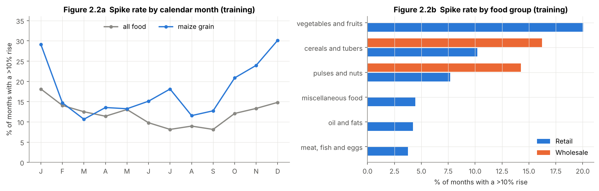

**The confounder: a shared price trend**
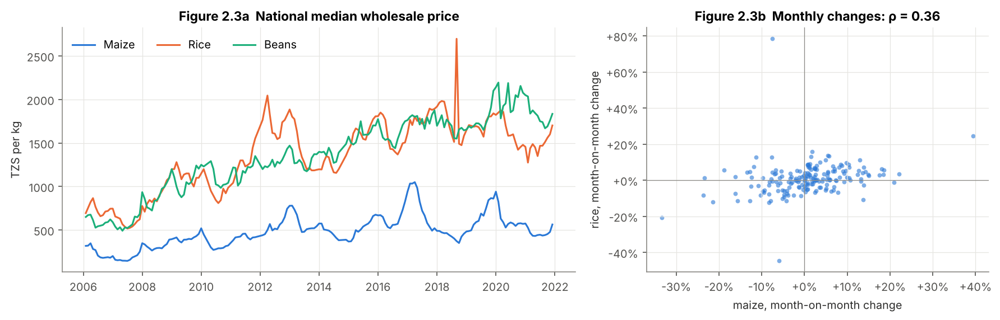

**Nearby markets co-move**
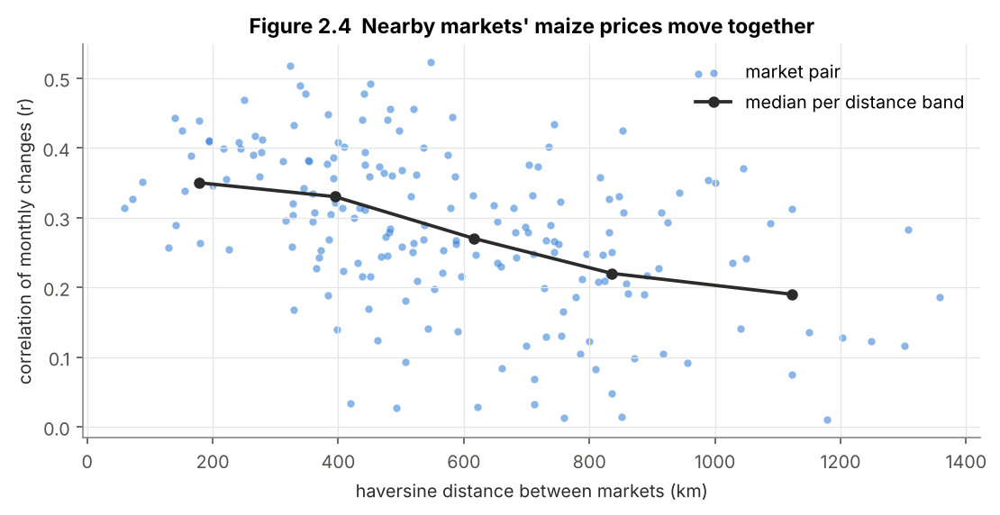

**What each spike threshold means for the Ministry**
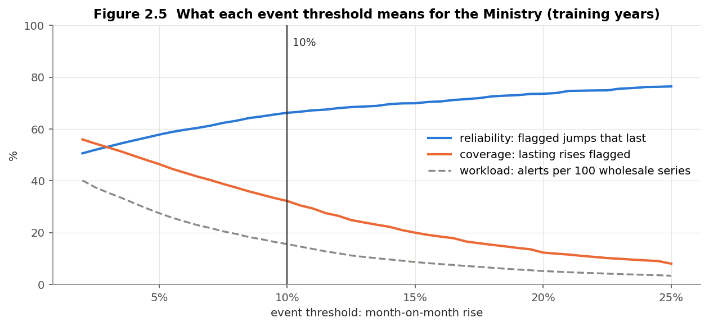

**The spike rate changes over time**
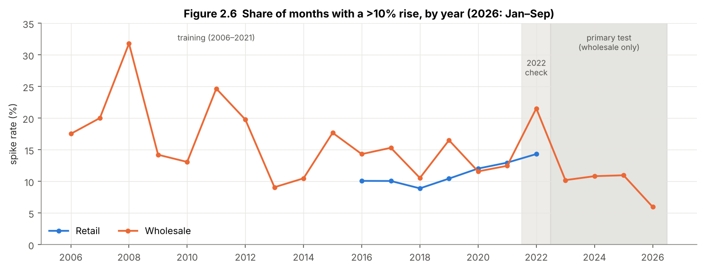

**Outlier cleaning against peer markets**
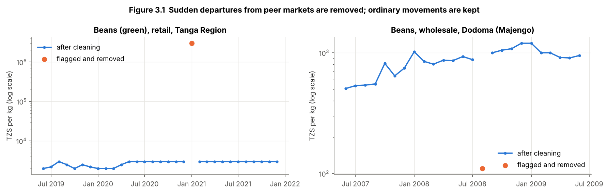

**Normalization chosen from each feature's shape**
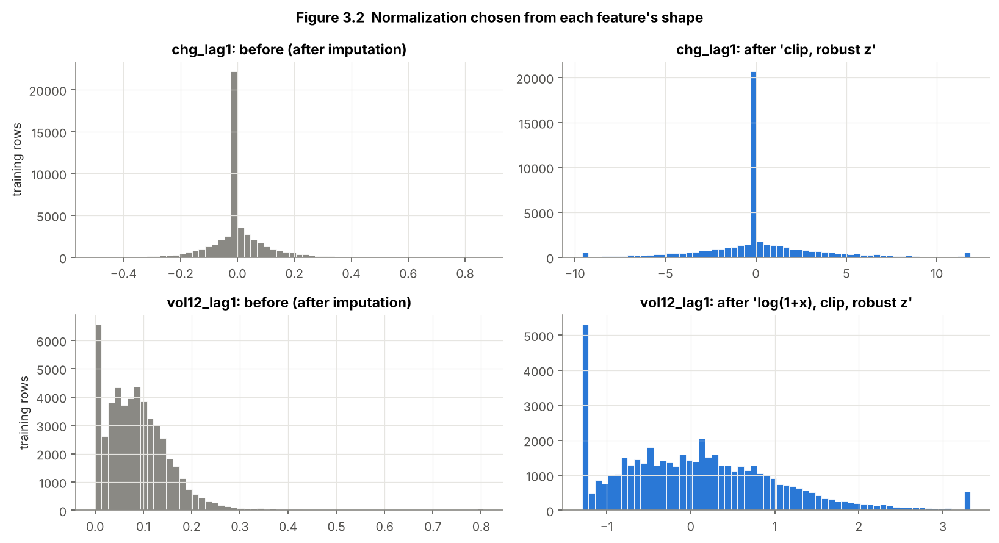

**PCA check: little redundancy**
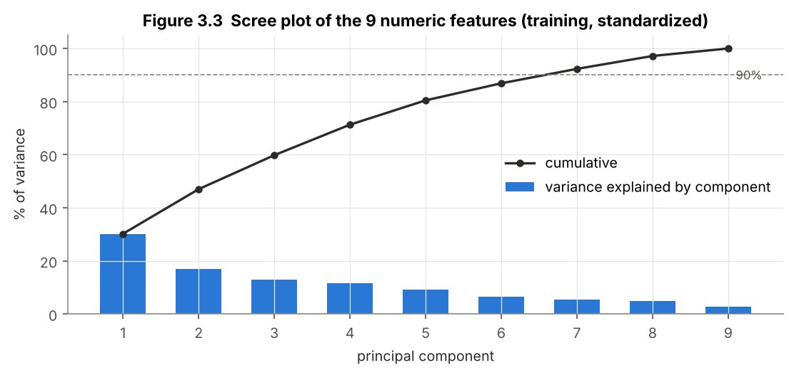

**Choosing tree depth: bias against variance in cross-validation**
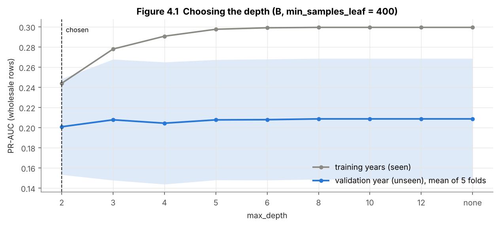

**Test-period precision-recall and ROC curves**
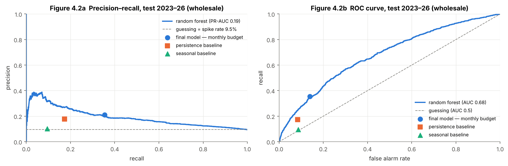

**What the random forest relies on**
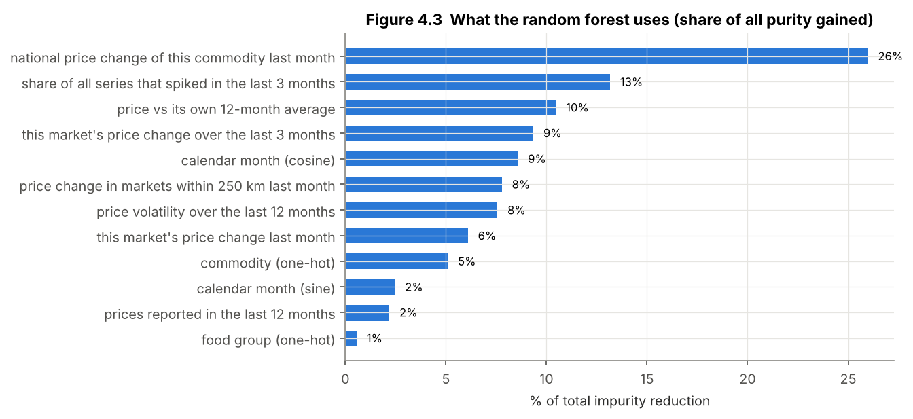

---

## Repository contents

```
Shambhavi_MiniProject.ipynb             analysis notebook (all outputs saved)
Shambhavi_MiniProject_Summary.pdf       one-page plain-language summary for the Ministry
data/Shambhavi_MiniProject_Data.csv     WFP price table (renamed, otherwise unchanged)
data/Shambhavi_MiniProject_Markets.csv  WFP markets table (renamed, otherwise unchanged)
figures/                                figures saved by the notebook
requirements.txt                        Python packages
LICENSE                                 MIT licence for the code
FEEDBACK.md                             response to instructor feedback, point by point
.gitattributes                          consistent line endings across operating systems
```

---

## How to run

Requires Python 3.10 or newer. From a fresh clone:

```bash
git clone https://github.com/Shambhavi-DSAI2006/tanzania-food-price-spikes.git
cd tanzania-food-price-spikes
python -m venv .venv
# Windows:  .venv\Scripts\activate      macOS/Linux:  source .venv/bin/activate
pip install -r requirements.txt
jupyter nbconvert --to notebook --execute --inplace Shambhavi_MiniProject.ipynb
```

Or open the notebook in VS Code or Jupyter and choose **Run All**. A full run takes about 3–5 minutes (most of it is the cross-validation in Section 4).

**Reproducibility checks built into the notebook:**
1. A **data fingerprint** (row count, date range and SHA-256 checksum of each CSV, independent of line endings) stops the run if the data file is not the analysed version.
2. A final **consistency check** recomputes every key number quoted in the text (85 numbers) and stops the run if any no longer matches.

---

## Licences

- **Code** (the notebook's code cells): MIT licence, see [LICENSE](LICENSE).
- **Data**: © World Food Programme, licensed under [CC BY-IGO](https://creativecommons.org/licenses/by/3.0/igo/). Redistributed here unchanged except for file names, with attribution as the licence requires. Source: https://data.humdata.org/dataset/wfp-food-prices-for-united-republic-of-tanzania
